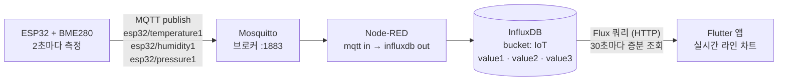

# 🔥 산불가드 — 산불 예방을 위한 실시간 환경 데이터 수집·시각화 IoT 시스템

> ESP32 센서가 측정한 **온도·습도·기압**을 MQTT로 보내 InfluxDB에 시계열로 쌓고,
> Flutter 앱에서 실시간 그래프로 보여주는 데이터 파이프라인입니다.

<!-- 📌 앱 화면 캡처나 하드웨어 사진을 여기에 넣으세요

-->

| 항목 | 내용 |
|---|---|
| 기간 | 2025.03 – 2025.06 (설계프로젝트 Ⅲ) |
| 인원 | 3인 |
| 기술 | ESP32 · BME280 · Arduino(C++) · MQTT(Mosquitto) · Node-RED · InfluxDB 2.x · Flutter · fl_chart |

| 이름 | 담당 |
|---|---|
| **황승구** | 코드 리뷰·피드백, 결과 보고서, 발표 자료 |
| 이지훈 | 코드 작성, 발표 자료 |
| 정태현 | 코드 리뷰·피드백, 결과 보고서, 발표 자료 |

<br>

## 1. 왜 만들었나

2025년 3월 산불은 약 10만 4천 ha(국토의 1% 이상)를 태웠습니다.
산불의 확산에는 **바람·습도·연료** 같은 환경 조건이 크게 작용하는데,
현재는 사람이 직접 상황을 확인하고 판단해야 합니다.
환경 데이터를 **자동으로, 계속** 모아 두면 지금은 실시간 모니터링에, 나중에는 위험 패턴 분석에 쓸 수 있다는 점에서 출발했습니다.

## 2. 데이터 파이프라인



| 측정값 | MQTT 토픽 | InfluxDB measurement | 단위 |
|---|---|---|---|
| 온도 | `esp32/temperature1` | `value1` | °C |
| 습도 | `esp32/humidity1` | `value2` | % |
| 기압 | `esp32/pressure1` | `value3` | hPa |

## 3. 구성 요소별 구현

### ① 센서 펌웨어 — [`firmware/wildfire_sensor/wildfire_sensor.ino`](firmware/wildfire_sensor/wildfire_sensor.ino)
- BME280을 I²C로 읽어 2초(`millis()` 기반, `delay` 없이) 주기로 세 값을 각각 발행
- MQTT 연결이 끊기면 5초 간격으로 재접속, 클라이언트 ID에 MAC 주소를 붙여 중복 접속 방지
- 기압은 Pa → hPa로 변환해 전송

### ② 수집·저장 — [`node-red/flows.json`](node-red/flows.json)
- `mqtt in` 노드 3개가 토픽을 구독하고 `influxdb out` 노드로 각 measurement에 저장
- 별도 서버 코드 없이 Node-RED 플로우만으로 수집 계층 구성

### ③ 시각화 앱 — [`app/lib/main.dart`](app/lib/main.dart)
- 앱 시작 시 최근 5분 데이터를 Flux 쿼리로 불러오고(30초 단위 평균), 이후 **30초마다 마지막 시점 이후 데이터만 증분 조회**
- 그래프마다 **최근 1,000개 포인트만 유지**해 오래 켜 둬도 메모리와 렌더링 비용이 늘지 않게 처리
- 새 데이터가 있을 때만 `setState`를 호출해 불필요한 다시 그리기 방지
- 첫 로딩 실패는 스낵바로 사용자에게 알리고, 주기적 갱신 실패는 로그만 남긴 뒤 다음 주기에 재시도

```dart
// 증분 조회: 이미 그린 마지막 시각 이후의 포인트만 추가
final filtered = newData.where((d) => d.x > (chartData[m]?.last.x ?? 0)).toList();
if (filtered.isNotEmpty) {
  dataWasUpdated = true;
  chartData[m]?.addAll(filtered);
  if (chartData[m]!.length > 1000) {
    chartData[m] = chartData[m]!.sublist(chartData[m]!.length - 1000);
  }
}
```

## 4. 코드 리뷰에서 개선한 점

- **불필요한 MQTT 콜백 제거** — 이 장치는 값을 *보내기만* 하는데 구독용 `callback()`이 남아 있던 것을 리뷰 중 발견해 제거했습니다.
- **앱 오류 처리 보강** — 네트워크 오류 시 로딩이 끝나지 않던 흐름을 `try / catch / finally`로 정리해, 성공·실패와 관계없이 로딩 상태가 해제되도록 했습니다.

## 5. 실행 방법

**1) 센서 (Arduino IDE)**
```text
1. firmware/wildfire_sensor/secrets.example.h 를 secrets.h 로 복사하고 와이파이·브로커 IP 입력
2. 라이브러리 설치: PubSubClient, ArduinoJson, SparkFun BME280
3. ESP32 보드 선택 후 업로드
```

**2) 브로커·수집** — Mosquitto와 InfluxDB 2.x를 실행하고, Node-RED에서 `node-red/flows.json`을 Import한 뒤 InfluxDB 토큰을 설정합니다.

**3) 앱**
```bash
cd app
flutter create .        # android / ios 등 플랫폼 폴더 생성 (최초 1회)
flutter pub get
flutter run --dart-define=INFLUX_URL=http://<서버IP>:8086 \
            --dart-define=INFLUX_TOKEN=<InfluxDB 토큰>
```

> 🔐 와이파이 비밀번호와 InfluxDB 토큰은 코드에 넣지 않습니다. 각각 `secrets.h`(git 제외)와 `--dart-define`으로 주입합니다.

```
wildfire-guard-iot/
├── firmware/wildfire_sensor/
│   ├── wildfire_sensor.ino     # ESP32 센서 → MQTT 발행
│   └── secrets.example.h       # 접속 정보 템플릿
├── node-red/
│   └── flows.json              # MQTT → InfluxDB 수집 플로우
└── app/
    ├── lib/main.dart           # 실시간 차트 앱
    └── pubspec.yaml
```

## 6. 회고와 확장 방향

- 지금은 **보여주기**까지만 합니다. 쌓인 시계열에 임계값(고온·저습) 알림을 붙이면 실제 경보 시스템이 됩니다.
- 온도 보정값(`-5.0`)이 코드에 고정돼 있어, 센서마다 다른 보정값을 설정으로 빼는 것이 좋겠습니다.
- 앱이 InfluxDB에 직접 쿼리하므로 토큰이 앱에 들어가야 합니다. 중간에 API 서버를 두면 토큰을 서버에만 두고 앱은 필요한 데이터만 받을 수 있습니다.
